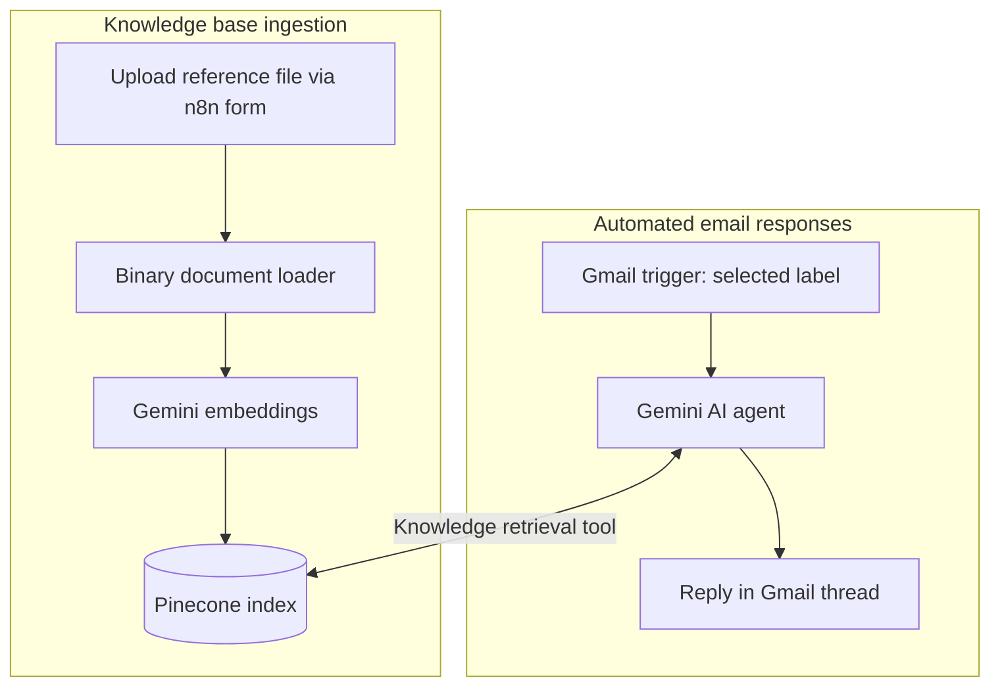

# RAG-Powered Customer Support Email Agent

An **n8n-based AI support agent** that reads incoming customer emails, retrieves answers from a Pinecone knowledge base, and automatically replies in the original Gmail thread using Google Gemini.

Built around **BrewNest Coffee Co.**, a sample e-commerce coffee brand, to demonstrate knowledge-grounded support automation. The workflow export is provided for review and adaptation; it is **not a hosted public service**.

## What it does

- Monitors a selected Gmail label on a one-minute polling schedule.
- Uses a Gemini-powered AI agent to interpret the customer's email, including multi-question requests.
- Retrieves product and policy facts from a Pinecone vector index before composing an answer.
- Drafts concise replies in the customer's language, with guardrails against inventing prices, shipping rules, refunds, or contact details.
- Sends an automatic **Gmail reply in the existing thread**, not a new outreach message.
- Supports document ingestion through a separate n8n upload form, Gemini embeddings, and Pinecone indexing.

## Architecture



The diagram abstracts the two branches of the exported n8n workflow. It does not imply that the agent updates orders, processes refunds, or provides order-status integrations.

## Technology stack

| Area | Technology | Role |
| --- | --- | --- |
| Workflow orchestration | n8n | Triggers, agent, and email automation |
| Language model | Google Gemini via n8n | Understand and draft email replies |
| Semantic search | Pinecone | Store and retrieve relevant source content |
| Embeddings | Google Gemini embeddings (`gemini-embedding-2` in export) | Vectorize documents and queries |
| Email | Gmail OAuth | Read labeled emails and reply in-thread |
| Document input | n8n Form Trigger | Upload knowledge-base files |

## Repository

```text
rag-customer-support-email-agent/
├── README.md
├── workflows/
│   └── customer-support-rag-workflow.json
└── .gitignore
```

## Setup

1. **Import the workflow:** Open n8n, select *Import from File*, and choose `workflows/customer-support-rag-workflow.json`.
2. **Connect credentials:** Configure your own Gmail, Google Gemini, and Pinecone credentials on the corresponding nodes. Account-specific credential references were removed from the public export.
3. **Configure Gmail scope:** Select or create a dedicated support-email label in Gmail, then replace `REPLACE_WITH_YOUR_GMAIL_LABEL_ID` in the Gmail Trigger filter with your label from n8n's label selector. Use a test inbox first; this workflow sends replies automatically.
4. **Configure Pinecone:** Create or select a Pinecone index, then update **both** Pinecone nodes to use the same index. Check embedding model compatibility and vector dimensions. The original demonstration used an index named `n8n1`.
5. **Prepare a knowledge base:** Upload reference documents through the **On form submission** workflow branch to insert knowledge vectors. The original knowledge-base documents were **not supplied** with this export, so bring your own sample catalog, FAQs, and store policies. Check your n8n document loader's support for the file formats you upload.
6. **Customize the prompt:** The AI Agent's system message currently references the BrewNest sample brand, sample support contact, and product-specific instructions. Replace these with your own store information before sending live emails.
7. **Test carefully:** First test the document-ingestion branch, then send sample questions from a separate email account to your labeled test inbox. Inspect the retrieved results and generated reply, and verify Gmail replies within the existing thread. Activate only after the flow is configured and tested in your environment.

Use an n8n version that supports the node types and versions in the export. Select an available chat model in **Google Gemini Chat Model**; the export leaves that model at the node default. Confirm that `models/gemini-embedding-2` is available to your account and supported by your n8n version, or select a compatible embedding model on both embedding nodes and rebuild the index as needed. Restrict access to the upload form before publishing it, since uploaded documents become part of the agent's knowledge base.

## Example questions to try

- “What products do you sell, and how much do they cost?”
- “Which countries do you ship to, and how long does delivery take?”
- “My coffee maker arrived damaged. What does your return policy say?”
- “Can you answer both the warranty and delivery questions?”
- “Can you offer me a discount?” (Should not invent one.)

These are **suggested test prompts**, not recorded execution results. Actual answers depend on the documents you index.

## Design choices & limitations

- **Knowledge grounded:** The agent is instructed to consult the retrieval tool for each question and avoid unsupported claims.
- **Graceful fallback:** When relevant information isn't available, the prompt directs the customer to human support instead of guessing.
- **Automatic sending:** The exported workflow uses an automatic Gmail reply node; it does not include a human review/approval step.
- **Inbox filtering:** The Gmail Trigger checks both read and unread messages under the selected label, with a maximum of five results per poll. The workflow has no explicit sender exclusion, processed-message tracking, or reply-loop guard; test label rules and repeat-message behavior before activation.
- **Prompt limitations:** Retrieval and factual accuracy are prompt instructions, not guarantees. The workflow has no separate answer-validation or prompt-injection filter.
- **No customer database:** The export does not integrate an order-management backend, order lookup, refund API, or ticketing CRM.
- **Email parsing:** The agent input uses `{{$json.text}}`. If your Gmail Trigger returns a different message-body field in your n8n version/configuration, adjust the mapping after inspecting a test execution.
- **Exported state:** The source export was inactive and contained no execution logs, so live execution success was not independently verified from the uploaded JSON.

## Portfolio note

This is an **e-commerce customer support RAG automation demo**. The n8n workflow and prompt are real project assets; no production volumes, answer-accuracy percentages, or savings are claimed here.
